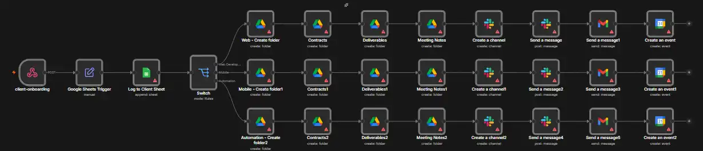
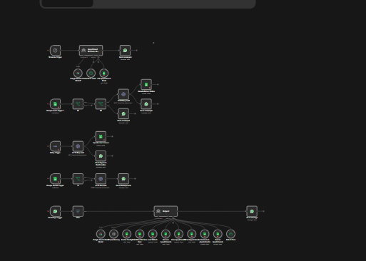

<div align="center">

# ⚡ n8n AI Automation Projects

**Production-style AI workflows that replace manual operations with intelligent, event-driven automation.**

Built with n8n, LLM agents and real-world APIs — designed around problems clinics and software houses actually face.


</div>

---

## 📌 Overview

This repository is a growing portfolio of end-to-end automation systems. Each project is self-contained and ships with:

- **`workflow.json`** — the exported n8n workflow, ready to import
- **`README.md`** — architecture, node-by-node logic and setup guide
- **`screenshots/`** — visual preview of the workflow canvas

Every workflow is built to handle the full lifecycle of a process — triggers, decision logic, AI reasoning, integrations and notifications — not just a single step.

---

## 🚀 Featured Projects

| Project | Problem Solved | Stack |
|---|---|---|
| 🩺 **[WhatsApp Doctor Appointment Bot](./whatsapp-doctor-appointment)** | Clinics lose time on calls and manual booking. Patients book, reschedule and cancel appointments directly on WhatsApp — with Stripe payments, automatic refunds and daily reminders. | n8n · WhatsApp Cloud API · Gemini · Google Sheets · Stripe |
| 🤝 **[Client Onboarding Automation](./client-onboarding-automation)** | Onboarding a new client takes hours of repetitive setup. One form submission provisions a Drive workspace, Slack channel, welcome email, kickoff call and a client log for the admin dashboard. | n8n · Webhook · Google Sheets · Drive · Slack · Gmail · Calendar |
| 🧑‍💻 **[DevBuddy](./devBuddy)** | New developers get stuck and seniors lose time answering repeat questions. An AI onboarding buddy sends a WhatsApp welcome, one task a day, answers from company docs, raises stuck alerts and sends a weekly manager report. | n8n · WhatsApp Cloud API · Gemini · Google Workspace |

---

## 🔍 Project Highlights

### 🩺 WhatsApp Doctor Appointment Bot
- Conversational **AI agent** handles booking, rescheduling and cancellation in natural language
- **Stripe** integration for payments and automated refunds on cancellation
- Scheduled **daily reminders** to reduce no-shows
- Google Sheets as a lightweight appointment database

### 🤝 Client Onboarding Automation
- **Single trigger, multi-system execution** — one webhook fans out across 6 services
- Auto-creates a structured **Google Drive** workspace and dedicated **Slack** channel
- Sends a branded welcome email and books the **kickoff call** on Google Calendar
- Logs every client for an **admin dashboard**

### 🧑‍💻 DevBuddy
- Split into **three modular workflows** — main assistant, daily task scheduler and weekly reporting
- Answers developer questions grounded in **company documentation**
- Detects blockers and sends **stuck alerts** to the team
- Generates an automated **weekly progress report** for managers

---

## 🖼️ Workflow Previews

<details open>
<summary><b>Client Onboarding Automation</b></summary>
<br>



</details>

<details open>
<summary><b>WhatsApp Doctor Appointment Bot</b></summary>
<br>



</details>

---

## ⚙️ Quick Start

```bash
1. Open a project folder and download its workflow JSON file
2. In n8n → New Workflow → ⋯ menu → Import from File
3. Connect your own credentials for each service node
4. Replace every YOUR_... placeholder with your values
5. Follow the project README for service-specific setup
6. Activate the workflow ✅
```

---

## 🔐 Security

- **No API keys, tokens or secrets** are committed to this repository
- All sensitive values are replaced with `YOUR_...` placeholders
- Every workflow uses n8n's encrypted credential store — you connect your own accounts

---

## 📁 Repository Structure

```
n8n-automation-projects/
├── README.md
│
├── whatsapp-doctor-appointment/
│   ├── workflow.json
│   ├── README.md
│   └── screenshots/
│
├── client-onboarding-automation/
│   ├── workflow.json
│   ├── README.md
│   └── screenshots/
│
└── devBuddy/
    ├── devbuddy-main.json            # AI assistant + Q&A
    ├── devbuddy-daily.json           # Daily task scheduler
    ├── devbuddy-weekly-report.json   # Manager report
    └── README.md
```

---

## 🛣️ What's Next

More workflows are being added — including RAG-based knowledge agents and multi-agent systems. ⭐ **Star the repo** to follow along.

---

<div align="center">

## 👨‍💻 Author

**Nouman Aslam** — MERN Stack & AI Automation Developer

[](https://github.com/CodeWithNouman99)
[](https://nouman-aslam.vercel.app)
[](mailto:mrnoumannomi7@gmail.com)

*Open to internships and junior developer roles in MERN & AI automation.*

</div>
